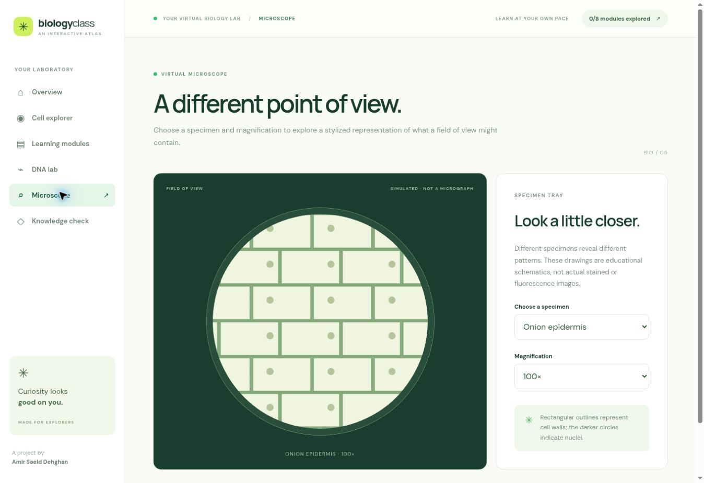
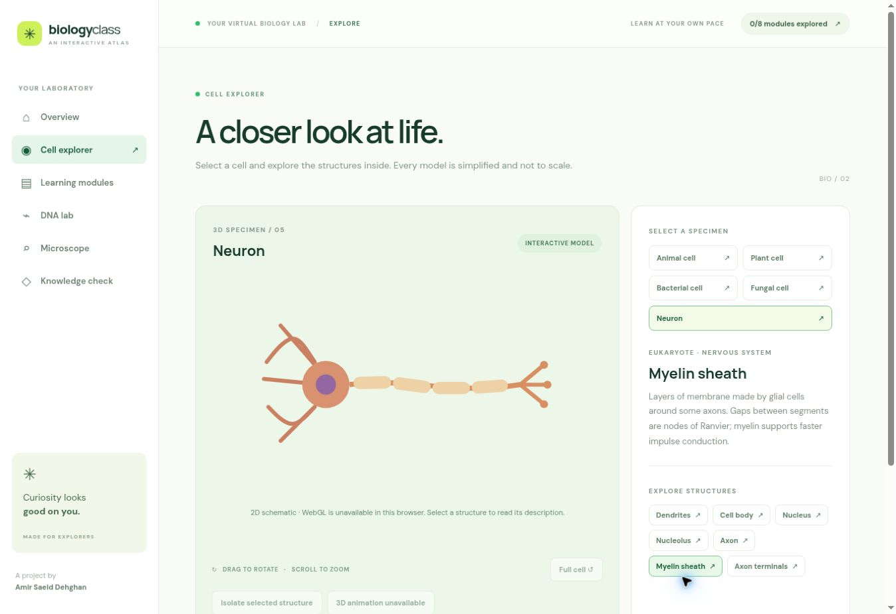

# 3D Biology Class

An independent interactive introduction to biology by **Amir Saeid Dehghan**. Explore five illustrative cell types including a multipolar neuron, a DNA helix, a simulated microscope, short biology lessons and a knowledge check.



Neuron screen in a browser without WebGL (the displayed drawing is the **2D fallback**, not the 3D model):



## What is implemented

- Animal, plant, bacterial, fungal and multipolar neuron models with rotatable 3D views and selectable structures. Procedural cutaway geometry includes a nucleus, rough ER, Golgi, mitochondria and other structures where applicable; the list changes with the specimen. Selecting an item highlights and focuses it, with an option to isolate it.
- A neuron with dendrites, soma, axon, myelin segments and terminals; a moving marker illustrates the direction of a signal, not an electrophysiological simulation.
- A simplified DNA double helix with rotation, zoom, reset and base-pair explanations.
- Eight short, step-based introductions: cell and molecular biology, genetics, cell division, human biology, botany, microbiology, and ecology and evolution. Mark modules explored and retain progress in the browser.
- A stylized microscope field with onion epidermis, blood and bacteria, specimen descriptions and magnification controls. These are **drawings**, not microscopy photographs.
- A three-question quiz with explanations, responsive layout, reduced-motion support and a text fallback when WebGL is unavailable.

**Scientific limitations:** All models are schematic, are not to scale and do not show every structure. The project is an introductory learning aid, not medical advice or a substitute for real specimens. Cell structures and sample shapes vary across species and tissues.

**Scope limitations:** This version does not yet contain a navigable 3D classroom, all 12 requested cell types, detailed human anatomy, the full set of biological animations, 3D microscope hardware, full Persian interface, complete lesson curricula, or photorealistic scanned/ready-made scientific assets. Browser-based WebGL rendering, camera movement and appearance could not be verified in the available test browser because WebGL was unavailable. A clearly labeled 2D schematic is displayed instead. Automated tests verify geometry generation and isolation logic but do not verify rendered pixels. The microscope, navigation, content selection and build were checked in that environment.

## Run locally

Requires Node.js 20.19+ or 22+ and npm.

```sh
npm ci
npm run dev
npm test
npm run build
npm run preview
```

The production files are generated in `dist/`. The configured base path is `/3d-biology-class-/`. Hash-based navigation works on GitHub Pages without server-side route rewrites.

## Deployment

The GitHub Actions workflow builds on pushes to `main` and deploys the artifact to GitHub Pages. In repository **Settings → Pages**, choose **GitHub Actions** as the source. The workflow's success and the actual Pages URL must be verified in the repository; configuring the workflow alone does not guarantee deployment.

## Structure and technology

- `src/main.js`: interface, navigation and learning interactions
- `src/scene.js`: procedural Three.js models and controls
- `src/data.js`: structured learning content and questions
- `src/style.css`: responsive visual system
- `screenshots/`: actual application screenshots
- `.github/workflows/deploy.yml`: GitHub Pages workflow

Built with Vite and Three.js. Models are generated procedurally in code; there are no third-party model assets. Google Fonts supplies DM Sans and Manrope when reachable, with system fallbacks. Three.js and Vite are distributed under their respective MIT licenses; see their package metadata. The project source is provided under the MIT License.

## Scientific references

- [OpenStax Biology 2e: Prokaryotic Cells](https://openstax.org/books/biology-2e/pages/4-2-prokaryotic-cells)
- [OpenStax Biology 2e: Eukaryotic Cells](https://openstax.org/books/biology-2e/pages/4-3-eukaryotic-cells)
- [OpenStax Biology 2e: DNA Replication](https://openstax.org/books/biology-2e/pages/14-3-basics-of-dna-replication)
- [OpenStax Biology 2e: Neurons and Glial Cells](https://openstax.org/books/biology-2e/pages/35-1-neurons-and-glial-cells)
- [OpenStax Biology 2e: Photosynthesis](https://openstax.org/books/biology-2e/pages/8-1-overview-of-photosynthesis)

---

# کلاس زیست‌شناسی سه‌بعدی

پروژه‌ای آموزشی و مستقل از **امیر سعید دهقان** برای آشنایی تعاملی با سلول‌ها، DNA و مباحث پایهٔ زیست‌شناسی.

## ویژگی‌ها

- پنج مدل ساده‌شدهٔ سلول جانوری، گیاهی، باکتریایی، قارچی و نورون با فهرست ساختارهای متناسب با هر سلول.
- مدل مارپیچ DNA، امکان چرخش و بزرگ‌نمایی و توضیح جفت‌شدن بازها.
- هشت درس کوتاه و مرحله‌ای دربارهٔ زیست سلولی و مولکولی، ژنتیک، تقسیم سلولی، بدن انسان، گیاه‌شناسی، میکروب‌شناسی و بوم‌شناسی و تکامل؛ پیشرفت در مرورگر ذخیره می‌شود.
- میکروسکوپ شبیه‌سازی‌شده با سه نمونه و کنترل بزرگ‌نمایی؛ تصاویر رسم‌شده‌اند و عکس میکروسکوپی واقعی نیستند.
- آزمون سه‌سؤالی با بازخورد، طراحی واکنش‌گرا، پشتیبانی از کاهش حرکت و توضیحات متنی هنگام در دسترس نبودن WebGL.

تصاویر واقعی محیط در ابتدای همین فایل قرار دارند. تصویر نورون مربوط به نمای جایگزین دوبعدی در مرورگر فاقد WebGL است. مدل‌ها شماتیک، خارج از مقیاس و شامل همهٔ اجزای سلول نیستند. این نسخه هنوز شامل کلاس سه‌بعدی قابل پیمایش، همهٔ ۱۲ نوع سلول درخواستی، مدل کامل بدن انسان، تمام انیمیشن‌های زیستی، میکروسکوپ سه‌بعدی، رابط کامل فارسی و مدل‌های آماده یا اسکن‌شدهٔ واقع‌گرایانه نیست. قابلیت انتخاب و جداسازی ساختارها در نمای سه‌بعدی پیاده‌سازی شده است. در مرورگر آزمایشی موجود WebGL در دسترس نبود و رندر سه‌بعدی و حرکت دوربین تأیید نشد.

## فناوری و اجرا

پروژه با **Vite** و **Three.js** ساخته شده و مدل‌ها با کد تولید می‌شوند. برای نصب و اجرا دستورات `npm ci` و `npm run dev`، برای آزمون هندسه `npm test` و برای ساخت نسخهٔ نهایی `npm run build` را اجرا کنید. فایل‌های خروجی در `dist/` ساخته می‌شوند. ساختار پروژه و راهنمای انتشار GitHub Pages در بخش انگلیسی آمده است؛ منبع انتشار در تنظیمات Pages باید روی GitHub Actions باشد و موفقیت انتشار جداگانه بررسی شود.

## منابع علمی و سازنده

پیوندهای منابع معتبر OpenStax در بخش انگلیسی آمده‌اند. سازنده: **Amir Saeid Dehghan — امیر سعید دهقان**.
